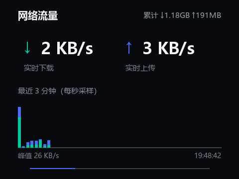
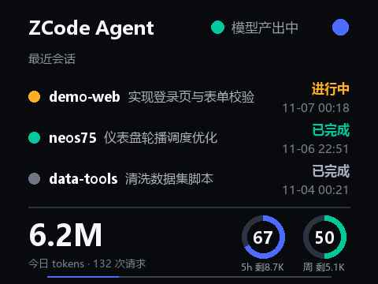
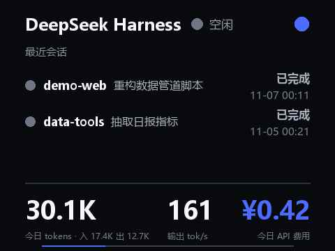
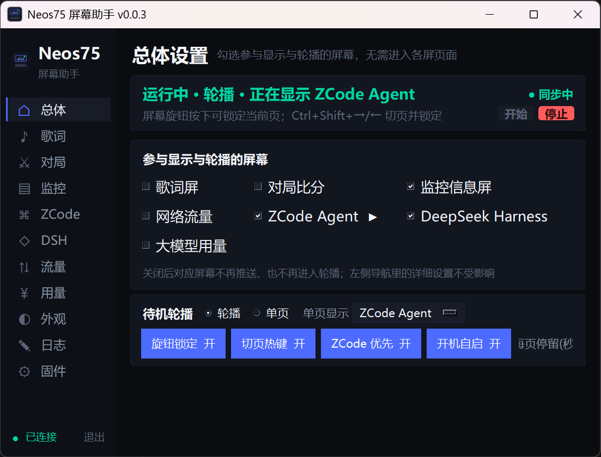

# Neos75 全屏固件 + 仪表盘信息屏

把 AULA Neos75 三模机械键盘的 480×360 小屏刷成**全屏固件**，并在屏幕助手的基础上跑起一套可轮播、可锁定的**桌面仪表盘**：在歌词、无畏契约比分、系统监控之外，新增 **ZCode Agent 进度、网络流量、大模型用量、DeepSeek Harness** 四块数据屏。

> 本项目基于两个开源仓库扩展：
> - 全屏固件补丁链：[hacker1232345/neos75-fullscreen](https://github.com/hacker1232345/neos75-fullscreen)（MIT）
> - 屏幕助手原项目：[shiqi17-zs/Neos75Lyrics-](https://github.com/shiqi17-zs/Neos75Lyrics-)（MIT）
>
> 两个子目录各自保留了上游的 LICENSE 与版权声明，详见文末[致谢与许可](#致谢与许可)。

## 屏幕一览

480×360 键盘屏渲染图——本项目新增的四块数据屏（演示数据由 `Neos75Lyrics-/tools/render_demo.py` 合成生成，不读取任何真实数据）：

| 网络流量 | ZCode Agent |
|---|---|
|  |  |

| 大模型用量 | DeepSeek Harness |
|---|---|
|  |  |

桌面程序「总体设置」页——侧栏新增 ZCode / DSH / 流量 / 用量四个页面入口，勾选参与显示与轮播的屏幕，集中管理待机轮播、旋钮锁定、切页热键与开机自启：



## 功能详解

### 1. 全屏固件 480×360

原厂屏幕为 320×320 居中显示，本方案刷入 [neos75-fullscreen](https://github.com/hacker1232345/neos75-fullscreen) v1.10.0 补丁链，点亮整块 480×360 面板：

- **补丁链三层**：原验证构建 → 清爽增强 → 任意页组件（默认关闭，按需启用）
- **两处上游校验元数据 bug 及绕过**：v1.10.0 的"一键全屏"（GUI 与命令行同样触发）存在
  ① `widget-none` 层 `changed_bytes` 按"本层改动数"声明 366，但校验按"净变化"对账（为 0）；
  ② `chainOf` 沿 parent 字段少算允许擦写扇区。
  `workspace/flash_runner.js` 在内存中修正这两处元数据后调用原版刷写器完成刷写，
  **全部字节级安全校验原样生效**，7 个 8KB 保护组逐字节回验 PASS。
- **验收**：刷写后 `screen_wallpaper.js status` 回报 480×360，测试图全屏无黑边
- ⚠️ **原厂固件备份是救砖的唯一手段**：`backup/mcu-before-fullscreen.bin`
  （SHA256 `76e3950a…cf84c939`）与 `workspace/original.bin` / `fullscreen.bin` **仅存本机、不入库**
  （`.gitignore` 已排除固件镜像），请务必在刷机前自行完成备份并妥善保存
- 刷写工具、协议研究记录与验证日志见 [`neos75-fullscreen/`](neos75-fullscreen/README.md)（含 docs/ 28 篇、evidence/ 回验日志、`tools/knob_config.py` 旋钮改键）

### 2. 仪表盘信息屏（本仓库新增四页）

上游歌词程序的歌词/对局/监控/托盘功能全部保留，新增四个页面 + 轮播调度：

| 页面 | 内容 | 数据源与刷新 |
|---|---|---|
| **ZCode Agent** | 任务状态（**任务进行中**=黄 / 会话间歇=黄 / 空闲=绿）、右上角锁定挂锁（橙色闭合=已锁定 / 蓝色张开=自动轮播）、最近 3 个会话（项目、标题、进行中/已完成/出错、时间）、今日 tokens 与请求数、智谱配额双环（5h/周剩余） | ZCode hooks 事件流（`~/.neos75_dashboard/events.jsonl`，10s）+ rollout `model-io-sess_*.jsonl` 本地聚合（60s）+ ZCode 任务索引只读 sqlite |
| **网络流量** | 实时 ↓↑ 速率、开机累计、最近 3 分钟每秒采样柱状图、峰值 | psutil `net_io_counters` 差分，后台 1s 采样线程，180 点历史 |
| **大模型用量** | DeepSeek 余额（赠金/充值拆分）、智谱 Coding Plan 双窗口**剩余**配额环形图（5h/周，环心剩余百分比、环下剩余 prompts）、GLM 今日本地用量 | DeepSeek `api.deepseek.com/user/balance` + 智谱 `open.bigmodel.cn/api/monitor/usage/quota/limit`（缓存 5 分钟）+ 本地 JSONL 聚合 |
| **DeepSeek Harness（DSH）** | 任务状态（任务进行中=黄 / 空闲=绿，同款锁定挂锁）、最近会话、今日 tokens（入/出拆分）、输出速度 tok/s、今日 API 费用 | `~/.dsh/sessions` 会话 zstd JSONL 解析（20s 扫描）；费用按 `dsh_prices` 单价表估算（标注为估算值），`dsh_local_models` 命中的本地模型不计费、仅统计用量与速度 |

四个页面渲染签名统一为 `render(cfg, out_path, lock_state=None) -> size`，480×360 JPEG q46 baseline（>9KB 自动降 q38），与上游 `scenes.render_info` 同风格，可直接互相替换进轮播。

### 3. 调度逻辑

- **锁定页最高**：屏幕旋钮「按下」循环锁定页面（解锁 → ZCode → DSH → 流量 → 大模型 → 信息屏 → 解锁）；锁定期间歌词/对局/轮播**全部让位**，只显示选定页面，直到再次按下解锁
- **显式动作即时切换**：热键 / 旋钮 / 托盘「推送到屏幕」/ 解锁等显式动作会绕过各页的推送节流（流量 1s、ZCode 2s、DSH 2s、大模型 30s），页面 ≤1.5s 即完成切换；自动轮播仍按节流运行以节省 HID 带宽
- **音乐播放时**：歌词屏优先（上游原逻辑不变，锁定时除外）
- **无音乐/暂停时**两种模式（仪表页可选）：
  - **轮播**：多页轮换，每页停留 `dash_dwell` 秒（默认 8，可调 4–60）；**ZCode 运行时优先**（`zcode_boost`）锁定 ZCode 页
  - **单页**：只显示选定的一个页面，不轮播
- **总体设置首页**：应用启动直接进入「总体」页，勾选参与显示与轮播的屏幕（歌词/对局/监控/流量/ZCode/用量/DSH，双向联动各页开关），待机轮播的模式/停留时长/ZCode 优先/旋钮/热键开关也集中在这一页

### 4. 屏幕旋钮与全局热键（安全方案）

> ⚠️ 历史教训：早期版本曾用低级键盘钩子（LL hook）拦截按键，与程序内重 GIL 任务竞争导致
> **全系统键盘阻塞**。该方案已彻底废弃，现用两类系统级安全机制。

- **屏幕旋钮「按下」= 锁定/解锁**：本机已把「按下」刷成 vendor 码（出厂为计算器键 → 刷为 vendor-226，改键工具见 `neos75-fullscreen/tools/knob_config.py`，可按原厂备份恢复），Windows 收到未映射的 VK 0xA9——**不再弹出计算器**；程序经 Raw Input（WM_INPUT，投递型消息，任何情况下都不可能阻塞键盘输入）捕获按下事件循环锁定页面。出厂固件用户按下仍会打开计算器，建议同样刷改键固件（或在系统中改掉计算器快捷键）；监控页「旋钮锁定」开关可关闭，音量旋钮不受影响
- **全局热键**（RegisterHotKey 注册，只有精确组合键触发，比 hook 安全）：
  - `Ctrl+Shift+→` 下一页并锁定 · `Ctrl+Shift+←` 上一页并锁定 · `Ctrl+Shift+↓` 锁定/解锁
  - Ctrl+Alt+箭头被显卡驱动的屏幕旋转热键占用，故用 Ctrl+Shift；注册失败记录日志，页面按钮仍可用
- **屏幕旋钮「旋转」**：固件内部直接给屏幕发翻页指令（A5 帧），不上报主机，软件无法感知；若一定要旋转切页，需刷 knob 改键固件（见 `neos75-fullscreen/tools/knob_config.py`，安全可恢复）或覆盖屏幕旋钮旋转代码（高风险，上游 README 明确警告）

### 5. ZCode hooks 接入（agent 实时进度）

在 `~/.zcode/cli/config.json` 注册六个事件（SessionStart / UserPromptSubmit / PreToolUse / PostToolUse / PostToolUseFailure / Stop），均指向 `Neos75Lyrics-/src/zcode_hook.py`（快进快出 <50ms，绝不阻塞会话）：

```json
{
  "hooks": {
    "enabled": true,
    "events": {
      "PreToolUse": [
        { "hooks": [ { "type": "process",
                       "command": "<python.exe 绝对路径>",
                       "args": ["<仓库路径>\\Neos75Lyrics-\\src\\zcode_hook.py"],
                       "timeoutMs": 5000,
                       "statusMessage": "Neos75 屏幕同步" } ] }
      ]
    }
  }
}
```

其余五个事件注册同一脚本。**注意：hooks 只对新启动的 ZCode 会话生效**，已开启的会话不加载新 hooks；重启 ZCode 或新开会话后 ZCode 页即开始显示实时事件。手动测试：

```bash
echo '{"session_id":"t","hook_event_name":"PreToolUse","tool_name":"Bash","tool_input":{"command":"ls"}}' | python Neos75Lyrics-/src/zcode_hook.py
```

## 快速开始

**前置要求**：Windows 10/11、Python 3.11+、AULA Neos75 键盘、USB 有线连接（2.4G/蓝牙不转发屏幕数据）、同步时退出 AULA Hub。

```bash
# 1. 刷全屏固件（详见 neos75-fullscreen/ 内 README；刷前务必备份原厂固件）
#    （可选）刷屏幕旋钮「按下」改键（vendor 码）——旋钮锁定免弹计算器：
#    neos75-fullscreen/tools/knob_config.py

# 2. 安装屏幕助手依赖
pip install -r Neos75Lyrics-/requirements.txt

# 3. 启动
cd Neos75Lyrics-/src
python Neos75Lyrics.py        # 或 pythonw.exe 无控制台运行
```

- 侧栏「开始 / 停止」控制同步；「仪表」页可开关各页轮播、调停留时长、手动推送单页、填写 API Key、看轮播预览
- 智谱 Key 在「仪表」页粘贴后点「保存并刷新」；DeepSeek Key 程序会自动读取 ZCode 保存的配置，也可在仪表页手填
- 开机自启：**固件**页里开关（程序自带功能）；托盘图标可关窗后台运行 / 退出
- ZCode hooks 按上文[第 5 节](#5-zcode-hooks-接入agent-实时进度)注册

## 配置与数据位置

| 文件 | 作用 |
|---|---|
| `~/.neos75_lyrics/config.json` | 全部配置与 API Key（`zhipu_api_key` / `deepseek_key` / `dsh_prices` / `dsh_local_models` 等）；**密钥只存本机配置文件，不写入仓库代码与日志** |
| `~/.neos75_dashboard/events.jsonl` | ZCode hook 事件流（>2MB 自动截断一半） |
| `~/.zcode/cli/config.json` | ZCode hooks 注册 |
| `~/.dsh/sessions/` | DeepSeek Harness 会话数据（只读解析） |

## 目录结构

```
.
├── README.md                  # 本文件
├── docs/screens/              # README 截图（新屏渲染图，演示数据合成）
├── neos75-fullscreen/         # [上游] 全屏固件补丁链 + DFU 工具 + 验证记录（MIT）
│   ├── dashboard/ desktop/ firmware/ tools/ wallpaper/ tests/
│   ├── docs/                  # 协议研究与刷写记录（28 篇）
│   ├── evidence/              # 刷机逐字节回验日志
│   └── tools/knob_config.py   # 旋钮改键固件工具
├── Neos75Lyrics-/             # [上游+扩展] 屏幕助手（MIT）
│   └── src/
│       ├── Neos75Lyrics.py    # 主程序（桌面 GUI）
│       ├── lyrics_screen.py   # [修改] 轮播调度、push_module、新配置项
│       ├── scenes.py          # [上游] 信息屏/歌词/对局/监控渲染
│       ├── zcode_hook.py      # [新增] ZCode hook 接收端（append JSONL）
│       ├── zcode_agent.py     # [新增] ZCode 页：事件聚合 + token 统计
│       ├── traffic_scene.py   # [新增] 流量页：1s 采样 + 180 点历史
│       ├── llm_usage.py       # [新增] 大模型页：DeepSeek/智谱 REST（5min 缓存）
│       ├── dsh_agent.py       # [新增] DSH 页：会话解析 + 费用估算 + 速度
│       ├── hotkey.py          # [新增] RegisterHotKey 全局热键
│       ├── knob_hook.py       # [新增] Raw Input 屏幕旋钮监听
│       └── log_keys.py        # [新增] 按键诊断监听（调试用，写本地日志）
├── workspace/                 # 刷机辅助脚本（路径相对仓库解析；固件镜像不入库）
├── backup/                    # 原厂固件备份（不入库，救砖用）
└── tools/                     # 安装包（不入库）
```

## 故障排查

| 现象 | 处理 |
|---|---|
| 屏幕推不上 | 退出 AULA Hub；确认 USB 有线（2.4G/蓝牙不转发屏幕数据） |
| 智谱显示"未配置" | 仪表页粘贴 Key 点"保存并刷新"，或检查 `~/.neos75_lyrics/config.json` |
| ZCode 页空白 | hooks 需新会话生效；`wc -l ~/.neos75_dashboard/events.jsonl` 确认事件在增长 |
| DeepSeek 显示"未配置 API Key" | 确认 ZCode 已配置 DeepSeek 供应商，或在仪表页手填 |
| DSH 页无会话 | 确认 `~/.dsh/sessions/` 存在会话文件；DSH 页依赖 `zstandard` 包（`pip install zstandard`） |
| 屏幕回到 320×320 | 固件被恢复/重置，用备份重新刷（见上文全屏固件一节） |

## 致谢与许可

- [hacker1232345/neos75-fullscreen](https://github.com/hacker1232345/neos75-fullscreen) — 全屏固件补丁链、DFU 刷写工具、协议研究（MIT，见 `neos75-fullscreen/LICENSE`）
- [shiqi17-zs/Neos75Lyrics-](https://github.com/shiqi17-zs/Neos75Lyrics-) — 屏幕助手主程序、歌词/对局/监控页（MIT，见 `Neos75Lyrics-/LICENSE`）
- 键盘 USB/DFU 协议研究过程中的公开资料来源见 `neos75-fullscreen/THIRD_PARTY_NOTICES.md`
- 本仓库整体以 MIT 协议发布，详见 [LICENSE](LICENSE) 与 [THIRD_PARTY_NOTICES.md](THIRD_PARTY_NOTICES.md)

感谢上游作者的开源工作。欢迎 Issue / PR。
